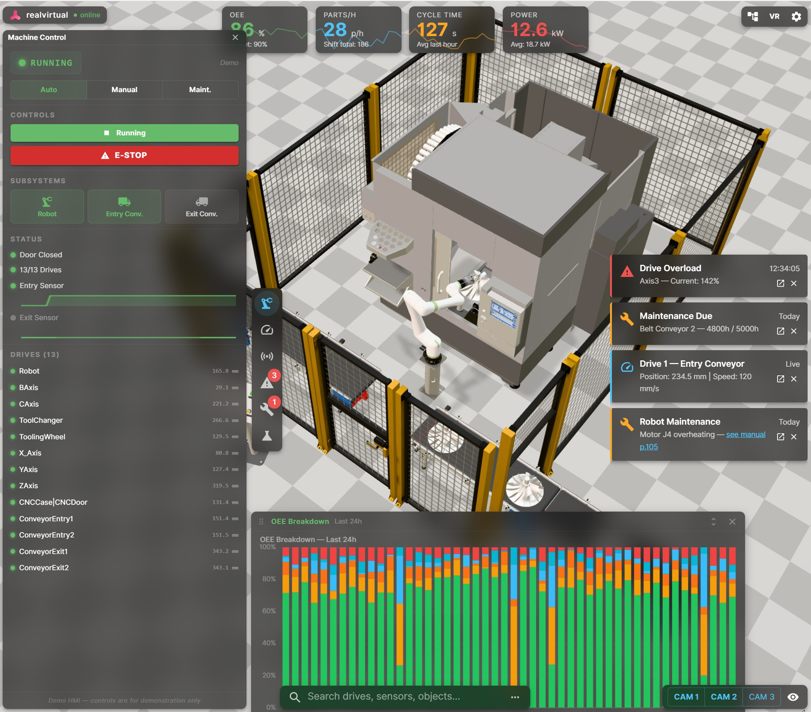

# XYvirtual WEB

**Browser-Based 3D HMI, Machine Information System, and Digital Twin Viewer for Industrial Automation**

[](https://www.gnu.org/licenses/agpl-3.0)
[](https://www.typescriptlang.org/)
[](https://threejs.org/)
[](doc-ai-integration.md)



XYvirtual WEB is an open-source, browser-based 3D HMI and digital twin viewer for manufacturing. Load any standard GLB/glTF file and view it as an interactive 3D model in the browser. For full digital twin functionality — drives, sensors, transport simulation, signal wiring, and KPI dashboards — use GLB files enriched with `rv_extras` metadata, either exported from the upstream Unity tool [realvirtual.io](https://realvirtual.io) Professional or authored manually. No installation required on the viewing device.

**One link. Any device. Live Digital Twin.** Run it locally in two commands — see [Quick Start](#quick-start).

> XYvirtual WEB is based on realvirtual WEB by realvirtual GmbH ([realvirtual.io](https://realvirtual.io)). Copyright and licensing terms are in [License](#license).

## User guides

Start with the [English quick start](docs/user/en-US/quickstart.md) or [中文快速上手](docs/user/zh-CN/quickstart.md). The [user manual](docs/user/README.md) covers model import, saving, media, offline tours, diagnostics and 22 FAQs in both languages. A complete searchable offline guide, three UI tutorials and bilingual subtitles ship in `dist/user-help/` after building. Open `user-help/index.html` directly. Contextual Help/F1 follows the delivery's `services.documentation` setting.

## What It Does

XYvirtual WEB replaces traditional desktop HMI and SCADA visualization with a modern, browser-based 3D experience. Connect to real PLCs through a gateway (this project's own OPC UA gateway, or optionally XYvirtual CONNECT) or directly over MQTT, TwinCAT HMI or ctrlX, and operators see live machine states — drive positions, sensor readings, alarms, KPIs — all in the context of the machine's 3D layout. Unlike flat panel HMIs, operators see *what* is happening, *where* it is happening, and *why*.

### Key Capabilities

- **Workspace Modes** — One application, four workspaces, switchable from the toolbar or via `?mode=viewer|hmi|planner|des`: **Viewer** (just show the machine — model and running kinematics, no panels and no authoring), **HMI** (operate and monitor), **Planner** (assemble layouts), **DES** (event-driven material-flow analysis).
- **Live 3D HMI** — Real-time PLC signal visualization via WebSocket Realtime or MQTT. Drive monitoring, sensor states, alarm management (latch, acknowledge, shelve, history), KPIs configured from live signals, and production charts powered by [Apache ECharts](https://echarts.apache.org/).
- **Signal Linking by Drag & Drop** — Drag a live interface signal straight onto a component slot (Forward, TargetSpeed, SensorOccupied, …). Direction and value type are checked, connections are saved with the layout, and signals can be monitored and forced.
- **Collision Detection** — Give a node one of six collision roles (Tool, Workpiece, Machine, Robot, Environment, None); while the simulation runs, every pair of bodies with *different* roles is checked against each other.
- **Machine Information System** — Attach documents, maintenance guides, technical drawings, and manuals directly to 3D components. Technicians click a part and see its documentation in context — accessible from any device on the shop floor.
- **Transport Simulation** — Full in-browser simulation engine at 60 Hz fixed timestep: conveyor surfaces, sources, sinks, sensors with AABB collision, grippers, and material flow.
- **LogicStep Sequencing** — Serial/parallel containers, signal conditions, delays, drive commands — ported from the upstream Unity product realvirtual.io Professional.
- **WebXR (VR/AR)** — Immersive visualization on Meta Quest, Apple Vision Pro, and AR on Android/iOS with surface detection.
- **Layout Planning** *(Beta)* — Assemble factory layouts directly in the browser: drag reusable parts from a library onto a grid, connect them with typed snap points, and position them with transform gizmos. Ships with a standard parts library and can load any GLB catalog straight from a GitHub repository.
- **Multiuser Sessions** *(Beta)* — Real-time collaboration with avatars, shared camera views, roles, and late-join state sync. Needs a multiuser host or relay server (the Unity-side MultiplayerWEB service, port 7000), which is not part of this repository — see [doc-multiuser-system.md](doc-multiuser-system.md).
- **Plugin Architecture** — Extend with custom plugins for project-specific HMI, KPI dashboards, maintenance workflows, and industrial interfaces.
- **AI-Ready (MCP)** — Built-in [Model Context Protocol](https://modelcontextprotocol.io) bridge lets AI assistants like Claude inspect, control, and debug a running XYvirtual WEB instance — read drive states, set signals, query scene hierarchy, and automate testing through natural language. Uses the in-repo Node [MCP bridge](mcp-bridge/README.md), or the MCP endpoint of XYvirtual CONNECT where CONNECT is installed.

## Use Cases

### 3D HMI / Operator Dashboards
Web-based HMI connected to real PLCs through a gateway over WebSocket Realtime, or directly over MQTT. Live signal visualization, KPI overlays, drive monitoring — replacing desktop HMI applications with a browser link.


### Machine Information System
Attach PDFs, maintenance guides, technical drawings, operating manuals, and spare part lists directly to individual 3D components. Technicians open a link on their tablet, click on a motor or valve, and immediately see its documentation, maintenance history, and real-time status — all in 3D context, on-site or remotely. No more searching through binders or file shares.

### Sales & Product Presentation
Interactive 3D models that let prospects explore machines live in the browser. More convincing than slides, more accessible than installed software. Share a link — done.

### Product Configurators
Build browser-based 3D product configurators where customers select options, variants, and accessories — and see the result rendered in real time. Combine with the plugin system to add pricing, BOM generation, or quote workflows.

### Layout Planning
Assemble factory layouts directly in the browser — drag conveyors, robots, fixtures, and pallets from a parts library onto a grid, connect them with typed snap points, and arrange them with transform gizmos. Ships with a standard parts library, and can additionally load GLB catalogs from a URL or GitHub repository.


**Try it locally:** start `npm run dev` and open the app with `?mode=planner`.

### Training & Onboarding
Operators learn machine behavior interactively before touching the real system. No software installation, no VPN, no IT department required.

### Remote Acceptance & Support
Share virtual commissioning models with customers for review and sign-off — worldwide, instantly.

## Quick Start

```bash
# Requirements: Node.js 22 (the version CI and the delivered workspaces use)
# Clone the repository (increase buffer for large GLB model files)
git config --global http.postBuffer 524288000
git clone https://github.com/OwnDing/realvirtual-WEB.git
cd realvirtual-WEB

npm install
npm run dev          # Vite dev server with HMR
```

Drop `.glb` files (exported from realvirtual.io Professional, or any glTF tool) into `public/models/` — they appear automatically in the model selector.

```bash
npm run build        # Production build -> dist/ (local only, nothing published)
npm run preview      # Preview production build
npx tsc --noEmit     # Type check (community view)
npm test             # Run browser tests (headless Chromium via Playwright)
npm run test:node    # Run Node.js tests (fs, glob, ESLint instance)
npm run test:all     # Run both Node + browser tests
npm run e2e          # Run Playwright end-to-end tests (e2e/)
npm run lint         # ESLint (flat-config, boundaries rule)
```

**Type checking:** plain `npx tsc --noEmit` is the **community view** — the base `tsconfig.json`
excludes the generated list of private-dependent tests (`tests/private-dependent-tests.json`), so it
type-checks exactly what a clone of this repository actually contains. `npm run typecheck` is the
*maintainer* full check: it uses `tsconfig.full.json` and **requires the private sibling repository**
`../realvirtual-WebViewer-Private~`, which is not part of this repository — running it without that
folder produces a wall of unresolvable `@rv-private/*` errors. Use `npx tsc --noEmit`.

`npm run deploy` is the upstream realvirtual publishing script for its Bunny CDN
(`web.realvirtual.io`). It needs `BUNNY_*` credentials this project does not hold, and its GitHub
workflow is manual-only. To host a build yourself, serve the `dist/` folder produced by
`npm run build` from any static web server — see [doc-deploy.md](doc-deploy.md) — or use the
Offline Appliance (`appliance/`, Linux and Windows packages with HTTPS entry, access service,
gateway and project storage).

## Operating Modes

| Mode | Description |
|------|-------------|
| **Standalone** | Pure browser simulation — no gateway, no PLC. The fixed-timestep simulation loop runs the full digital twin offline. |
| **Live** | Connected to a gateway over WebSocket Realtime v2 — the gateway talks to the PLC and streams signals into the browser in real time. This is the usual arrangement for PLC protocols, because the browser cannot speak them directly. |
| **Direct** | The browser connects straight to the equipment over a browser-capable protocol (MQTT over WebSocket, Beckhoff TwinCAT HMI, Bosch Rexroth ctrlX) — no gateway in the loop. |

Two gateways speak the same WebSocket Realtime v2 protocol, so the browser side is identical:

- **XYvirtual Gateway** (`gateway/`, part of this repository) — OPC UA client, role-checked and
  audited writes, value history in InfluxDB for the trend panel. It ships in the Offline Appliance.
- **XYvirtual CONNECT** — a separate, optional third-party product for further protocols
  (S7, ADS, Modbus, …) and its own AI agents. This repository holds only the browser side of
  its contract (see [doc-webviewer-interface.md](doc-webviewer-interface.md)).

## Deployment Options

- **Self-Hosted** — Serve `dist/` on your own infrastructure, configured through the versioned deployment configuration
- **Offline Appliance** — Linux/Windows package for plant networks: HTTPS entry, HMI roles and audit, own gateway, server-side projects (on-site hardware acceptance still pending)
- **Protected Presentations** — Server-side accounts, time-limited and revocable shares, watermarking
- **Single-file Demo** — Export a scene as one offline HTML file for sales presentations
- **Kiosk Mode** — Lock all configuration UI for shopfloor panels and public displays

## Tech Stack

| Component | Technology |
|-----------|-----------|
| 3D Rendering | [Three.js](https://threejs.org/) (WebGL + WebGPU *(Beta)* + WebXR) |
| UI Framework | React 19 + MUI 7 |
| Charts | Apache ECharts 6 |
| Build Tool | Vite 6 |
| Language | TypeScript 5.9 |
| Testing | Vitest (browser-mode) + Playwright |

## Industrial Connectivity

Connect to real automation systems via:

| Protocol | Description |
|----------|-------------|
| **WebSocket Realtime** | Bidirectional PLC signal streaming through a gateway (primary live mode) |
| **MQTT** | IoT and cloud connectivity |
| **Beckhoff TwinCAT HMI** | Direct connection to a TcHmiServer (symbol discovery, subscriptions, writes) |
| **Bosch Rexroth ctrlX** | Direct ctrlX CORE integration |

Behind WebSocket Realtime, the own gateway currently speaks **OPC UA**. Other controller
protocols (Siemens S7, Beckhoff ADS, Modbus, …) need XYvirtual CONNECT or the Unity-side
realvirtual.io Professional.

## Architecture

XYvirtual WEB works with **any standard GLB/glTF file** — load a CAD export from Blender, SolidWorks, Fusion 360, or any other 3D tool and view it as an interactive 3D model in the browser.

For full digital twin functionality, the GLB file becomes the single source of truth: signal bindings, kinematic definitions, drive parameters, sensor thresholds, and component metadata are embedded via the `rv_extras` schema. The upstream Unity product [realvirtual.io](https://realvirtual.io) Professional provides the authoring tools to add this metadata during Unity export, but the `rv_extras` format is open and documented — you can author it with any toolchain.

```
src/
  core/
    engine/          # Simulation engine (drives, sensors, transport)
    hmi/             # React HMI components (panels, tooltips, settings)
  hooks/             # React hooks
  interfaces/        # Industrial protocol adapters (WebSocket, MQTT, TwinCAT HMI, ctrlX)
  plugins/           # Built-in plugins (multiuser, annotations, FPV, XR)
    demo/            # Demo charts and HMI (OEE, cycle time, energy, drive/sensor overlays)
    models/          # Per-model plugins (auto-loaded when a model is selected)
  private-stubs/     # No-op stubs for commercial modules — what makes this community
                     #   edition build and run without the private sibling repository
tests/               # Vitest browser-mode tests
e2e/                 # Playwright E2E tests
public/models/       # GLB model files
gateway/             # Own industrial gateway (OPC UA → WebSocket Realtime v2, history)
mcp-bridge/          # Local MCP server (stdio) for AI assistants
appliance/           # Offline Appliance packaging and runtime services
```

## Extending XYvirtual WEB

Plugins can contribute UI components to predefined **slots** in the HMI layout — KPI bar, button panel, message panel, settings tabs, and more. The built-in demo plugin uses all of these:


The plugin system makes it easy to add custom functionality. Create a plugin class and register it with `viewer.use()`:

```typescript
import type { RVViewerPlugin } from './core/rv-plugin';
import type { RVViewer } from './core/rv-viewer';

class MyPlugin implements RVViewerPlugin {
  id = 'my-plugin';

  init(viewer: RVViewer) {
    // Access drives, signals, scene — all from the RVViewer API
    viewer.on('model-loaded', () => {
      const drives = viewer.drives;          // all drives in the scene
      const signals = viewer.signalStore;    // PLC signal store
      console.log(`Model loaded with ${drives.length} drives`);
    });
  }
}

// Register in main.ts or a model-specific plugin module
viewer.use(new MyPlugin());
```

**Per-model plugins** load automatically when a specific GLB is selected. Place them in `src/plugins/models/<ModelName>/index.ts`:

```typescript
export const models = ['MyMachine'];  // matches MyMachine.glb

export function registerModelPlugins(viewer) {
  viewer.use(new MyCustomDashboard());
}

export function unregisterModelPlugins(viewer) {
  viewer.removePlugin('my-dashboard');
}
```

For the full plugin API — UI slots, event bus, hooks, context menus, and tooltip extensions — see [doc-extending-webviewer.md](doc-extending-webviewer.md).

## Documentation

End users start with the bilingual **[user manual](docs/user/README.md)** (also built into `dist/user-help/` for offline use).
Developers start with **[Architecture](doc-webviewer.md)**. The full in-repo documentation set:

**Getting started & architecture**
| Document | Contents |
|----------|----------|
| [Architecture](doc-webviewer.md) | Full architecture, component reference, configuration, workspace modes |
| [From Unity to the Web](doc-unity-to-web.md) | Porting patterns and the AI coding-agent workflow |
| [Lifecycle](doc-lifecycle.md) | Runtime lifecycle: model load, fixed-step loop, pause, reset, dispose, events |
| [Node Paths](doc-node-paths.md) | How component, signal and kinematic references are written and resolved |

**Building & extending**
| Document | Contents |
|----------|----------|
| [Plugin Development](doc-extending-webviewer.md) | Plugin system, custom components, UI slots, hooks |
| [Events & Hooks](doc-events-and-hooks.md) | Typed event bus and plugin/component lifecycle hooks |
| [Component Behaviors](doc-behaviors.md) | Per-node TypeScript behaviors and naming conventions |
| [Component Scripting](doc-scripting.md) | JavaScript behaviors authored inside the GLB, run in a QuickJS sandbox |
| [Behavior Modelling](doc-behavior-modelling.md) | Continuous vs DES material-flow modelling (beginner's guide) |
| [Signal Architecture](doc-signal-architecture.md) | Signal store: GLB import to React UI, PLC direction, batching |
| [Signal Connection Logic](doc-signal-connection-logic.md) | Slots, connection states, drag & drop linking, forcing, persistence |
| [UI Visibility](doc-ui-visibility.md) | Which axis decides what is shown: plugin modes vs. UI visibility rules |

**Authoring & operations**
| Document | Contents |
|----------|----------|
| [Layout Planner](doc-layout-planner.md) | Library objects, catalogs, snap points, pivots, deep-links |
| [Persistence](doc-persistence.md) | Scene model, edit ops log, drafts, storage layout |
| [Document Linking](doc-document-linking.md) | PDF/AASX datasheet linking and metadata |

**Connectivity & collaboration**
| Document | Contents |
|----------|----------|
| [Industrial Interfaces](doc-webviewer-interface.md) | WebSocket Realtime, ctrlX, MQTT, signal flow, new-interface guide |
| [Multiuser System](doc-multiuser-system.md) | Sessions, shared views, avatars |
| [AI Integration](doc-ai-integration.md) | AI integration and the MCP bridge |
| [MCP Tools](webviewer.mcp.md) | MCP tools reference (read state, set signals, build layouts) |

**Deploy & debug**
| Document | Contents |
|----------|----------|
| [Building & Deploying](doc-deploy.md) | Local test build vs. publishing, private projects, credentials, CI |
| [Debugging Guide](doc-web-debugging.md) | Debugging tools, debug API, E2E tests, workflow |

## AI-Enabled Development (MCP)

XYvirtual WEB is AI-enabled through the **Model Context Protocol (MCP)**. AI coding assistants
like [Claude Code](https://claude.ai/code) can drive the running scene directly. The browser
defines the `web_*` tools; either of two servers relays them:

- **Node MCP bridge** ([`mcp-bridge/`](mcp-bridge/README.md), in this repository) — launched by the
  assistant as a stdio process; the browser connects to it on port 18714 (Settings → AI Bridge → Port).
- **XYvirtual CONNECT**, where installed — hosts the endpoint at `http://localhost:5100/mcp`
  (the browser's default bridge port).

Through either one the assistant reaches:

- **XYvirtual WEB** — list drives and positions, read/write PLC signals, query the scene
  hierarchy, inspect sensor states, debug transport simulation, take screenshots of the running
  scene.
- **Unity Editor** *(optional)* — with the upstream realvirtual.io Professional, the separate
  [realvirtual MCP](https://github.com/game4automation/realvirtual-MCP) package adds Unity editor
  tools: create GameObjects, set component properties, run simulations, manage scenes, run tests.

This means AI assistants can design, build, test, and debug industrial digital twins end-to-end.

### Getting Started with AI Development

This repo includes a tool-neutral AI Coding governance system plus a
[Claude Code](https://claude.ai/code) compatibility setup:

- **[AGENTS.md](AGENTS.md)** — Short, tool-neutral Agent entry and P0 rules
- **[docs/README.md](docs/README.md)** — Governed product, architecture, contract, plan and acceptance index
- **[docs/governance/](docs/governance/)** — Document priority, AI safety, change control, Definition of Done and Harness
- **[docs/exec-plans/](docs/exec-plans/)** — Executable plans for cross-cutting or compatibility-sensitive work
- **[CLAUDE.md](CLAUDE.md)** — Claude Code compatibility pointer to the same governed entry
- **[.claude/commands/](.claude/commands/)** — Slash commands for common workflows: `/dev`, `/debug`, `/test`, `/build`, `/inspect`, `/license-check`
- **[webviewer.mcp.md](webviewer.mcp.md)** — MCP tools reference for browser-side scene inspection

Start by reading `AGENTS.md`. Use `./scripts/verify.sh governance` for documentation-only
changes and `./scripts/verify.sh all` for the governed static, Node, browser and build gates.
The `all` scope deliberately does not claim E2E, real PLC/device, CONNECT, WebXR or manual UX validation.

## Relationship to the Unity Platform

The upstream realvirtual.io platform follows a two-platform architecture, and XYvirtual WEB keeps
its delivery half compatible with GLBs exported from the engineering half:

| | Unity (Engineering Platform, upstream) | XYvirtual WEB (Delivery Platform) |
|---|---|---|
| **Purpose** | CAD import, behavior modeling, virtual commissioning | Browser-based 3D HMI, monitoring, collaboration |
| **Technology** | Unity Engine, C#, Unity Industry | Three.js, TypeScript, React |
| **Deployment** | Desktop application, XR headsets, mobile devices | Any modern browser |
| **PLC connection** | Native protocol drivers | WebSocket / MQTT gateway |
| **Target user** | Automation engineer, simulation expert | Operator, service tech, sales, customer |

## Contributing

Contributions are welcome. Please note that XYvirtual WEB is **dual-licensed**
(AGPL-3.0-only + commercial): by submitting a pull request or any other
contribution, you agree to the grant of rights described in
[CONTRIBUTING.md](CONTRIBUTING.md), which allows realvirtual GmbH to also
license your contribution under its commercial license.

## License

Copyright (C) 2025–2026 [realvirtual GmbH](https://realvirtual.io)

This program is licensed under the **GNU Affero General Public License v3 (AGPL-3.0)**.

**What this means:** If you use, modify, or build upon XYvirtual WEB in your own project — including deploying it as a web service — you must publish your **complete project** under the same AGPL-3.0 license and make it freely available. This includes all source code, configuration, and **all content delivered through the application** (such as GLB model files, settings, and plugins). This applies whether served over a network or distributed directly.

The "Powered by XYvirtual WEB" watermark and the XYvirtual logo must remain visible and unmodified in all AGPL deployments. Removal or modification of any branding requires a commercial license.

See [LICENSE](LICENSE) for the full license text.

**SPDX-License-Identifier:** `AGPL-3.0-only`

### Commercial License

If you want to use XYvirtual WEB in proprietary or closed-source products — or keep your 3D models, project configuration, and plugins private — a commercial license is available.

Contact: [xyvirtual.io/en/company/license](https://xyvirtual.io/en/company/license)

---

[User manual](docs/user/README.md) | [Architecture](doc-webviewer.md) | [Governed documentation](docs/README.md) | Upstream: [realvirtual.io](https://realvirtual.io)
