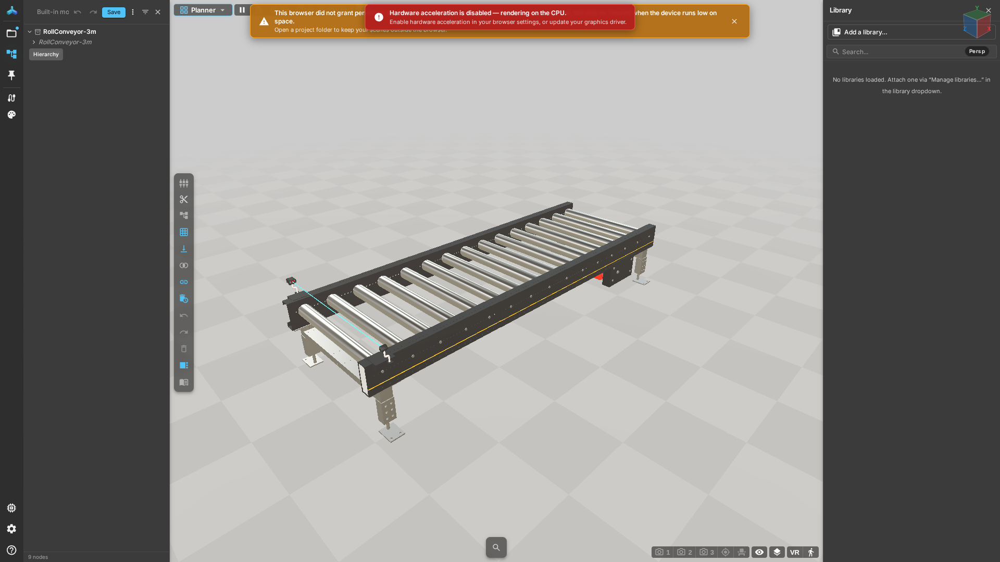

# Interface and navigation

## Prerequisites
A model is loaded. Workspace, deployment locks and embedding affect visible controls; a missing entry is not necessarily a fault.

## Steps
1. Drag the canvas to orbit and scroll to change distance. On a trackpad or touch screen, use gestures supported by your browser and device.
2. Press Shift+F to fit the whole model. Leave any active tool before moving the camera if necessary.
3. Open **Hierarchy** to find parts and select an object to inspect available properties. Model and device names are user data and do not change with the UI language.
4. Change Chinese or English in the language selector in Settings. Reloading should restore your personal choice without changing the shared project.
5. Click Help or press F1. The target follows the current panel and workspace. F1 does not interrupt text input.

## Hierarchy {#hierarchy}
Hierarchy shows the current document and objects. The document card's more menu exposes supported operations. Read-only references and editable copies may offer different actions.

## The tool strip {#the-tool-strip}
Measurement, annotation and camera tools depend on the workspace. Exit a tool before dragging to explore. Do not confuse equipment actions with camera navigation.

## Settings {#settings}
Deployment policy controls settings. Kiosk, guest and embedded contexts may hide help or diagnostics. If help is disabled, open the user guide in the delivery package directly.

## Result and recovery
Camera movement does not change geometry; language selection only changes presentation. If the model disappears, fit the view and inspect hierarchy visibility. Then consult [Model import](models.md) and [Support](support.md).

