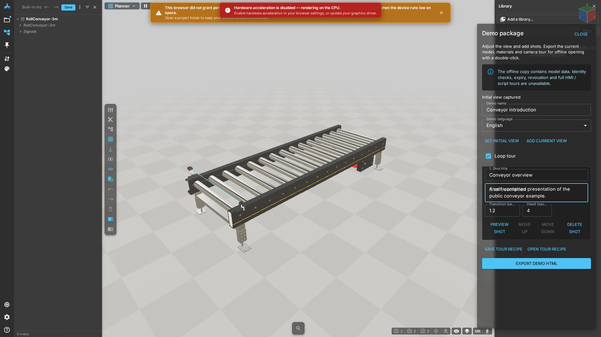

# Your first offline presentation

## Prepare
Download the [public roller conveyor GLB](../../../public/library/PalletHandling/RollConveyor-3m.glb) shipped with this guide, or a self-contained GLB you may distribute. Fifteen minutes is a first-use learning target, not a guarantee; models and devices affect completion time. Do not use production signals for training.

## Steps
1. Download the example above. Open the workbench, choose that local GLB from the model entry point, and wait for its resources. The recording uses the same RollConveyor-3m model.
2. Drag to orbit and scroll to zoom. Press Shift+F to fit the model, then compose the view.
3. Open the current document card's more menu in Hierarchy and choose **Demo package**.
4. Use a perspective camera. Click **Set initial view**, then **Add current view**. Enter the shot title, description and dwell time.
5. Move to another view and add a second shot. Preview each shot and check the order.
6. Choose **Save tour recipe** and retain the downloaded `.demo.json`. Save the model separately.
7. Choose the presentation language and **Export demo HTML**. Wait for the download.
8. Copy the HTML to the recipient machine. Disconnect the network and open it in a desktop browser with WebGL 2 and permission to run local HTML scripts. Choose **Play tour**.

## Expected result
The recipient can see the model, play shots and explore freely. Dragging stops the tour; replay starts from the first shot. HTML contains the complete model and cannot be remotely revoked. Check distribution rights before sharing.

## Recovery
Resolve missing references in the source document. Follow the error instructions for unsupported scripts or external resources. Cancellation prevents download; encoding already in progress may continue until resources can be released. Delivery is successful only after both download and playback work. See [Offline tours](tours.md).

## Example

The animated conveyor-sensor example includes a Director script and cannot be exported as this static presentation. Use the roller conveyor above for this exercise; do not remove script protections to make an export succeed.
