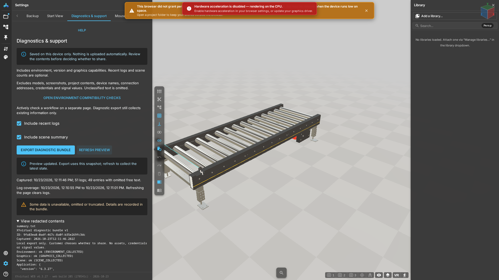

# Diagnostics and support

## When a failure occurs
Keep the current page open. Reloading clears this session's diagnostic history. Do not clear site data first: it may contain projects without backups.

## Export steps
1. Open **Settings → Diagnostics & support** and read the collection notice.
2. Choose whether to include recent logs and scene counts, then **Refresh preview**.
3. Expand **View redacted contents** and check the snapshot time and actual contents.
4. Choose **Export diagnostic bundle** and save the ZIP. If packaging is unavailable, the UI explicitly falls back to JSON.
5. Inspect the file yourself and decide whether to send it through your support process. The application does not upload it automatically.

## Expected result
The download uses the same snapshot as the preview. Successful collection is not health certification. Diagnostics exclude models, screenshots, project content, device names, addresses, credentials and signal values. Unknown logs are omitted. Unavailable, truncated and failed sections are marked.

## Environment checks and failure entry points
The environment check probes current graphics and storage capabilities. Active checks may use dedicated temporary files without reading business files. Load or graphics initialization errors can offer diagnostic export. Export cannot be guaranteed before JavaScript starts or after a browser crash.

## Next steps
Provide support with time, version, steps, expected and actual behavior, and the reviewed diagnostic file. Read back state after save or remote-write timeouts rather than repeating them blindly. Preserve diagnostics before reopening a model after graphics resource loss.

